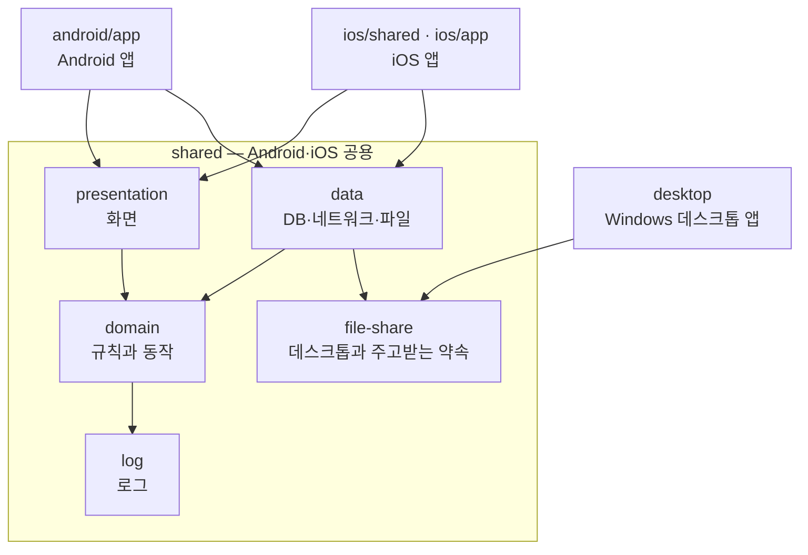

# JellyTube

음원을 모아 **가사와 함께 듣는** 음악 앱입니다.
Android 와 iOS 에서 같은 화면으로 동작합니다.
PC 에 있는 음악 파일은 함께 들어 있는 데스크톱 앱으로 폰에 보낼 수 있습니다.

## 무엇을 할 수 있나

**음원 모으기**
- 링크로 곡 하나, 또는 재생목록을 통째로 추가합니다.
- 폰에 있는 음악 파일을 가져오거나, 다른 앱에서 "JellyTube 로 열기"로 넘겨받습니다.
- PC 에서 데스크톱 앱(JellyTube File Share)으로 여러 곡을 한 번에 보냅니다.

**듣기**
- 플레이리스트, 찜, 셔플·반복, 구간 반복
- 재생 속도와 피치(키) 조절, 잠들기 타이머

**가사**
- 받은 곡의 가사를 자동으로 찾아 붙이고, 직접 검색하거나 시간에 맞춰 고칠 수 있습니다.
- 외국어 가사는 줄마다 번역과 읽는 법(음차)을 함께 보여 줍니다.
- 노래방 번호를 찾아 붙여 둡니다.

**그 밖에**
- 곡의 필요한 부분만 남기는 편집, 알람음·벨소리로 쓰기
- 비밀 플레이리스트: 숨은 입구로만 들어가고, 정해 둔 시간이 지나면 다시 숨습니다.
- 걸음 수 기록
- 하루 한 번 고른 폴더에 백업하고, 새 폰에서 복원합니다.
- Android 와 iPhone 사이에서도 곡·플레이리스트·가사를 통째로 옮깁니다.

## 어떻게 설치하나

| 플랫폼 | 방법 |
|---|---|
| Android | 릴리스 APK 를 직접 설치합니다. |
| iOS | [SideStore](https://sidestore.io/) 로 설치합니다. 무료 Apple ID 로 서명하므로 7일마다 SideStore 에서 갱신해야 합니다. |
| Windows | 데스크톱 앱 설치 파일(MSI·EXE)로 설치합니다. |

앱 스토어에는 배포하지 않습니다.

## 구조

Kotlin Multiplatform 으로, 화면을 포함한 코드 대부분을 Android 와 iOS 가 함께 씁니다.
화살표는 의존하는 방향입니다.



| 경로 | 내용 |
|---|---|
| `shared/domain` | 앱의 규칙과 동작 |
| `shared/data` | 로컬 DB, 네트워크, 파일, 기기 간 파일 공유 |
| `shared/presentation` | 화면 (Compose Multiplatform) |
| `shared/log` | 로그 |
| `shared/file-share` | 데스크톱 앱과 주고받는 약속 |
| `android/app` | Android 앱 |
| `ios/shared`, `ios/app` | iOS 앱 |
| `desktop` | Windows 데스크톱 앱 |

자세한 구조와 작업 규칙은 [AGENTS.md](AGENTS.md) 에 있습니다.

## 빌드

**준비물**: JDK 17, Android SDK, Python 3.11(Android 빌드가 파이썬 패키지를 받을 때 씁니다).
iOS 는 macOS 와 Xcode 가 필요합니다.

```bash
./gradlew :android:app:assembleDebug   # Android 개발용 앱 (Windows 는 gradlew.bat)
./gradlew :desktop:run                 # 데스크톱 앱 실행
./scripts/setup-ios-vendor.sh          # iOS: 클론 뒤 한 번. 그다음 Xcode 로 ios/app 을 연다
```

- 릴리스 서명 키는 저장소에 없습니다. 없으면 release 빌드는 서명 없이 나오고, 나머지 빌드는 그대로 됩니다.
- 브랜치는 `develop` 에서 따서 PR 을 엽니다. 브랜치 이름과 릴리스 규칙은 AGENTS.md 의 "브랜치와 릴리스" 절을 보세요.
